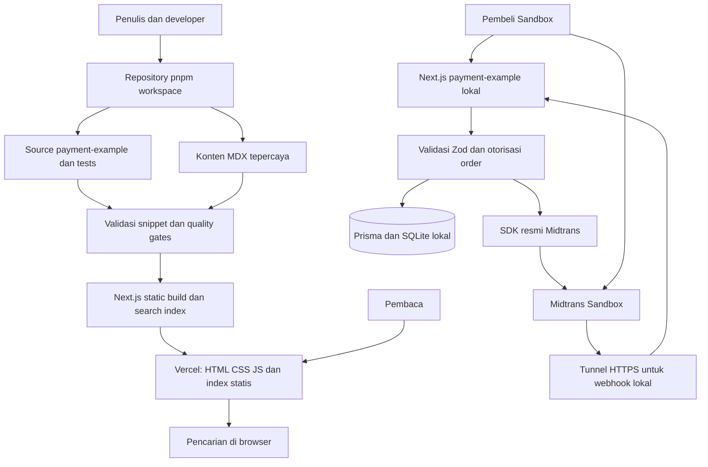

# Architecture Design

Status: **DRAFT — migrasi workspace TASK-002 disetujui dan selesai; keputusan desain lain menunggu persetujuan**  
Tanggal: 26 Oktober 2026  
Dasar: [PRD v1.0.0](../../PRD.md), terutama bagian 1–2, 7–9, 11–14; [WORKFLOW Phase 2](../../WORKFLOW.md).

## 1. Sumber requirement dan batas rancangan

Path PRD yang diminta, `docs/01-product/prd.md`, tidak ditemukan saat inspeksi. Dokumen ini menggunakan `PRD.md` di root. Pada TASK-002, developer memilih penataan Git root/workspace dan menegaskan pekerjaan dilanjutkan; PRD root existing menjadi baseline scope migrasi tersebut (A-01). PRD tidak dipindahkan atau diubah. Pilihan desain lain tetap usulan sampai disetujui secara relevan.

Requirement dari PRD: website tutorial berbahasa Indonesia, konten MDX, static export, pencarian client tanpa database/API eksternal, source contoh pembayaran teruji, Snap Redirect utama, Snap Popup opsional. Website dokumentasi tidak memproses pembayaran, tidak menggunakan database, CMS, atau login.

## 2. Kondisi repository

Tabel berikut adalah snapshot awal saat desain dibuat. Perkembangan aktual: commit template `7733eb7` telah dipush; TASK-002 selesai memindahkan Git ke root project dan template ke `apps/docs` pada branch `chore/task-002-workspace`. Frozen install, workspace discovery, lint, typecheck, build dan production smoke lokal telah berhasil; hasil dan batas validasi dicatat pada [handoff TASK-002](../03-planning/tasks.md). Perubahan migrasi belum di-commit/push.

| Area | Bukti saat inspeksi | Gap terhadap PRD |
| --- | --- | --- |
| Aplikasi | Template dalam `next-app/`; README masih template | Belum menjadi dua aplikasi |
| Framework | Manifest Next.js 16.4.2, React 19.3.1, TypeScript strict, Tailwind 4 | Versi belum dibuktikan melalui build/test |
| Komponen | Button, ThemeProvider, helper `cn` | Layout dokumentasi dan komponen konten belum ada |
| Konten/build | `app/page.tsx` placeholder; konfigurasi Next kosong | MDX, Shiki, static export, search index belum ada |
| Backend | Tidak ada Prisma, Zod, atau Midtrans SDK di manifest | Aplikasi pembayaran belum ada |
| Dokumentasi | PRD root; `docs/` kosong sebelum rancangan ini | Task breakdown dan desain belum tersedia |
| Git | `.git` berada di `next-app/`; belum ada commit, file sudah staged | PRD/design di luar Git aplikasi |
| Referensi visual | `design/design.png`, `design/index.css` | Belum diterapkan pada aplikasi |

## 3. Arsitektur target



Hanya `apps/docs` dipublikasikan sebagai website statis. `apps/payment-example` berjalan lokal untuk tutorial/testing dan memerlukan runtime Node.js. SQLite aplikasi contoh tidak ditempatkan pada filesystem sementara Vercel. Publikasi backend pembayaran merupakan keputusan terpisah, bukan bagian deploy dokumentasi.

## 4. Struktur dan tanggung jawab

Struktur target mengikuti PRD bagian 8: root workspace, `apps/docs`, `apps/payment-example`, `scripts/validate-snippets.ts`, dan `.github/workflows/ci.yml`.

| Modul target | Tanggung jawab |
| --- | --- |
| `apps/docs/app/` | Landing page, route MDX, metadata statis, 404, sitemap dan robots |
| `apps/docs/components/` | Sidebar, TOC, search, code block, copy button, theme toggle |
| `apps/docs/lib/docs-navigation.ts` | Urutan chapter, judul, route dan previous/next |
| `apps/docs/mdx-components.tsx` | Pemetaan elemen MDX ke komponen presentasi |
| `apps/payment-example/app/api/` | Route Handler checkout, sesi anonim dan webhook |
| `apps/payment-example/app/checkout/` | Katalog seed sederhana dan halaman status terlindungi |
| `apps/payment-example/lib/` | Prisma, Midtrans, validasi, logika checkout dan transisi status bersama |
| `apps/payment-example/prisma/` | Schema, migration dan seed produk |
| `apps/payment-example/tests/` | Unit/integration; Playwright untuk alur browser |
| `scripts/validate-snippets.ts` | Memastikan snippet tutorial sesuai source contoh |

Gunakan fungsi/modul langsung sesuai kebutuhan; tidak membuat microservices, repository layer generik, shared UI package, message broker, atau CMS. Database/API pada dokumen pendamping hanya milik aplikasi contoh.

### Transisi repository — A-02 disetujui untuk TASK-002

Developer telah memilih TASK-002 dan mengonfirmasi lanjut setelah tujuan pemindahan dijelaskan: satu Git root mencakup aplikasi, PRD, desain dan referensi visual; template digunakan kembali sebagai `apps/docs`. Migrasi selesai dengan riwayat commit/source existing dipertahankan. Tidak melakukan reset, menghapus riwayat, membuat nested repository, force push atau deployment. Kendala filesystem Windows, sisa cache ignored, pemeriksaan blob dan hasil validasi dicatat pada handoff task. Persetujuan ini tidak mencakup keputusan desain backend/UI lain.

## 5. Website dokumentasi

- `@next/mdx` mengompilasi konten lokal; `output: "export"`; seluruh route tersedia saat build. MDX hanya berasal dari contributor tepercaya, tidak dari input pengguna.
- Shiki berjalan saat build, tidak mengirim parser/highlighter penuh ke client. Heading ID dan TOC berasal dari heading MDX yang sama; ID unik dan deterministik.
- Search index berisi route, judul chapter, heading, dan teks tutorial tanpa markup/code panjang. Dihasilkan saat build dan dimuat ketika search dibuka. Pencarian substring/keyword sederhana cukup untuk 13 chapter; tidak perlu search service.
- Server Components untuk presentasi statis; Client Components hanya untuk drawer, search, copy, theme, dan active heading.
- Navigasi, internal links dan previous/next divalidasi terhadap route yang benar-benar dibangun. Snippet merujuk path source dan region bernama; verifier membandingkan teks hasil ekstraksi dengan MDX. Ketidaksesuaian menggagalkan CI.
- Setiap chapter menyertakan versi dependency, tanggal pengujian, hasil validasi, dan struktur penulisan PRD bagian 6. Teks penjelasan tetap ditulis manual, source snippet mengikuti aplikasi contoh.

## 6. Alur pembayaran

```mermaid
sequenceDiagram
    participant B as Browser
    participant A as Payment example
    participant D as SQLite
    participant M as Midtrans Sandbox
    B->>A: Inisialisasi sesi anonim
    A-->>B: Cookie HttpOnly
    B->>A: POST checkout + Idempotency-Key + items
    A->>D: Simpan order PENDING dan payment INITIATED secara atomik
    A->>M: createTransaction dengan order ID tetap
    M-->>A: Token dan redirect URL
    A->>D: Simpan hasil atau tandai UNKNOWN jika timeout
    A-->>B: Redirect URL atau hasil pending/retry terkontrol
    B->>M: Snap Redirect
    M->>A: Webhook
    A->>A: Validasi payload dan signature
    A->>M: Ambil status otoritatif
    M-->>A: Status, identitas transaksi dan nominal
    A->>D: Validasi dan update status dengan kontrol konkurensi
    A-->>M: Acknowledge setelah commit
    B->>A: Buka halaman status dengan cookie
    A->>D: Baca order milik sesi
    A-->>B: Status tersimpan; callback bukan bukti bayar
```

Panggilan jaringan berada di luar transaksi SQLite. Tidak ada transaksi atomik lintas database dan Midtrans; karena itu status pembuatan Snap dipisahkan dari status pembayaran. Timeout tidak boleh langsung menjadi FAILED atau membuat order baru. Rincian recovery, idempotensi dan transisi ada di [API](api-spec.md) dan [database](database.md).

## 7. Trade-off

| Pilihan usulan | Alternatif | Pertimbangan |
| --- | --- | --- |
| Dua aplikasi dalam pnpm workspace | Satu aplikasi full-stack | Sesuai PRD; menjaga static docs bebas secrets/backend, menambah konfigurasi CI |
| SQLite lokal + Prisma | Database terkelola | Sesuai tutorial, mudah direproduksi; tidak cocok untuk multi-instance atau serverless ephemeral |
| MDX lokal + search saat build | CMS/search eksternal | Tanpa backend dan biaya layanan; perubahan konten memerlukan rebuild |
| Satu payment attempt per order | Banyak attempts per order | Lebih mudah diajarkan dan dideduplikasi; retry tidak otomatis beralih ke transaksi baru |
| Token sesi anonim | Akun/JWT | Melindungi order tanpa menambah login; akses hilang ketika token kedaluwarsa/dihapus |
| Rekonsiliasi lokal/manual ketika diperlukan | Cron/queue | Cukup untuk contoh lokal; bukan jaminan recovery otomatis untuk layanan publik |

## 8. Validasi implementasi yang diwajibkan

Belum dijalankan dalam pekerjaan desain ini. Implementasi harus membuktikan:

- Docs: lint, typecheck, MDX compilation, static build, internal links, snippet verification, accessibility smoke test, desktop/mobile.
- Example: Prisma validate/generate, lint, typecheck, unit/integration tests dan production build; skenario PRD bagian 9.3 termasuk webhook duplikat, tidak berurutan dan SDK timeout.
- Sandbox E2E melalui tunnel HTTPS; hasil test bertanggal dicatat terpisah dari test dengan SDK mock.
- CI mencakup kedua aplikasi; deploy docs terhalang ketika quality gate wajib gagal. Catat Node.js dan versi dependency yang benar-benar diuji; jangan menyatakan manifest sebagai bukti kompatibilitas.

## 9. Register persetujuan dan risiko

| ID | Keputusan yang memerlukan persetujuan | Rekomendasi / status |
| --- | --- | --- |
| A-01 | PRD yang menjadi baseline | `../../PRD.md` digunakan untuk scope TASK-002 yang dipilih developer; path canonical yang diminta belum ada, requirement tidak diubah |
| A-02 | Transisi Git root dan struktur workspace | Disetujui dan selesai pada TASK-002, branch `chore/task-002-workspace`; riwayat/source existing dipertahankan |
| A-03 | Detail model data, satu attempt, recovery, kontrak sesi/API dan otorisasi | Setujui `database.md`, `api-spec.md`, `security.md` sebagai satu kontrak |
| A-04 | Batas request, rate limit, nominal, timeout dan masa akses | Angka usulan pada `security.md`; TBD sampai disetujui dan diuji |
| A-05 | Adaptasi font, token visual, breakpoints dan interaksi | Usulan pada `ui-ux.md`; hindari menyalin ketidakkonsistenan mockup |
| A-06 | Domain produksi dan URL source repository | Source GitHub sudah diketahui; domain produksi tetap TBD untuk canonical/OG/hosting |

Risiko utama: path canonical PRD belum dirapikan; sisa cache ignored `next-app/node_modules` terkendala akses Windows walau source/workspace baru sudah diverifikasi; kompatibilitas versi Prisma/SQLite/SDK belum diuji; webhook dapat datang berulang atau terlambat; Snap timeout dapat meninggalkan hasil ambigu; SQLite dan limiter lokal tidak memberikan jaminan multi-instance. TASK-002 selesai dalam persetujuan migrasi yang spesifik; keputusan desain lainnya dan deployment tetap menunggu persetujuan yang relevan.

## 10. Referensi teknis

- [Static export Next.js](https://nextjs.org/docs/app/guides/static-exports): digunakan sebagai referensi batas static build; fitur yang memerlukan request/runtime tidak ditempatkan pada docs.
- [Panduan MDX Next.js](https://nextjs.org/docs/app/guides/mdx): verifikasi kembali terhadap versi Next yang terpasang saat implementasi.
- [SDK resmi Midtrans](https://github.com/Midtrans/midtrans-nodejs-client): source branch default dapat berubah; versi terpasang harus dikunci dan diuji.

Dokumen pendamping: [Database](database.md), [API](api-spec.md), [UI/UX](ui-ux.md), [Security](security.md).
