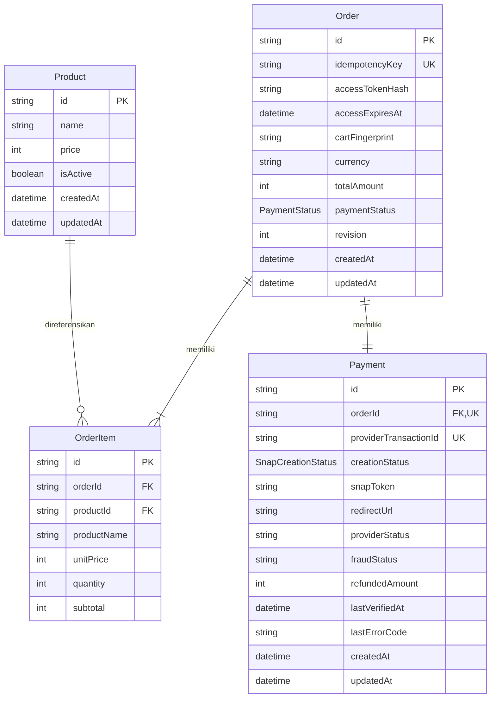

# Database Design dan ERD

Status: **DRAFT — usulan A-03, menunggu persetujuan**  
Baseline dan keputusan lintas dokumen: [Architecture](architecture.md), termasuk keterbatasan lokasi PRD.

## 1. Scope dan teknologi

Database hanya untuk `apps/payment-example`. Website dokumentasi tidak menggunakan database. Sesuai PRD: Prisma, SQLite lokal, adapter `@prisma/adapter-better-sqlite3`, dan enum internal pembayaran. Schema berikut adalah model konseptual, bukan migration atau schema Prisma siap dieksekusi.

Satu order memiliki satu payment attempt. Contoh tidak mengelola stok, ongkir, diskon, pajak, akun pengguna atau dashboard refund karena tidak diminta. Produk berasal dari seed lokal. Nominal menggunakan integer rupiah (IDR), tanpa floating point, dengan batas yang menjaga seluruh perhitungan dalam rentang integer SQLite/Prisma yang dipilih.

## 2. ERD

`providerTransactionId`, `snapToken`, `redirectUrl`, `providerStatus`, `fraudStatus`, `lastVerifiedAt`, dan `lastErrorCode` nullable sebelum respons terkait tersedia. `orderId` dikirim sebagai `order_id` Midtrans; tidak ada mapping ID kedua yang ambigu. ID order dibuat server secara acak dan memenuhi batas format/panjang SDK teruji.

## 3. Invariant dan constraints

| Area | Aturan |
| --- | --- |
| Money | `price`, `unitPrice`, `subtotal`, `totalAmount` positif; quantity integer positif; `subtotal = unitPrice * quantity`; total adalah jumlah subtotal |
| Snapshot | Nama dan harga disalin dari database saat checkout; perubahan Product tidak mengubah riwayat order |
| Cart | Tolak product ID duplikat; fingerprint berasal dari pasangan product ID/quantity yang diurutkan; bukan harga frontend |
| Currency | Hanya `IDR` pada contoh; provider amount harus sama dengan total tersimpan |
| Idempotency | `Order.idempotencyKey` unik global; replay wajib memeriksa kepemilikan sesi dan fingerprint |
| Relations | `OrderItem.orderId` dan `productId` wajib; unique gabungan `(orderId, productId)`; `Payment.orderId` unique wajib |
| Lifecycle | Order/items/payment awal dibuat dalam satu transaksi; tidak ada order tanpa items/payment setelah commit |
| Ownership | SHA-256 token sesi disimpan sebagai `accessTokenHash`; token mentah hanya di cookie; periksa `accessExpiresAt` |
| Refund | `0 <= refundedAmount <= totalAmount`; jumlah kumulatif tidak boleh menurun |
| Concurrency | `revision` mulai 0; conditional update terhadap revisi yang dibaca, lalu increment dalam transaksi yang sama |
| Deletion | Gunakan restrict untuk relasi finansial; produk dinonaktifkan melalui `isActive`, tanpa endpoint penghapusan transaksi |

Index: PK/FK yang dibutuhkan akses relasi, unique idempotency key, unique payment order ID, unique provider transaction ID saat tersedia, dan unique pasangan item. Tidak menambah index analitik atau tabel histori sampai ada kebutuhan nyata. Constraint lintas tabel dan nominal yang tidak dapat dinyatakan Prisma wajib dijaga dalam transaksi dan diuji; foreign key enforcement harus dibuktikan pada adapter SQLite yang dipakai.

`Order.paymentStatus` adalah sumber kebenaran status internal; `Payment.providerStatus` menyimpan status mentah terakhir yang diterima setelah verifikasi. Tidak menyimpan enum internal kedua pada Payment agar tidak ada dua sumber kebenaran.

## 4. Status

`PaymentStatus` mengikuti PRD: `PENDING`, `PAID`, `FAILED`, `CANCELED`, `EXPIRED`, `REFUNDED`, `PARTIALLY_REFUNDED`.

`SnapCreationStatus` usulan: `INITIATED`, `READY`, `UNKNOWN`, `FAILED`. Status ini menjelaskan hasil pembuatan Snap, bukan bukti pembayaran. Tidak melakukan create ulang pada `INITIATED`/`UNKNOWN` tanpa rekonsiliasi yang menyelesaikan ketidakpastian. Kegagalan persist sesudah SDK sukses juga masuk recovery ambigu.

| Status otoritatif Midtrans | Kondisi | Kandidat internal |
| --- | --- | --- |
| `pending` | Nominal/identitas valid | PENDING |
| `settlement` | Nominal/identitas valid | PAID |
| `capture` | `fraud_status = accept` | PAID |
| `capture` | `challenge` atau fraud belum jelas | Tetap PENDING untuk ditinjau; tidak PAID |
| `deny` atau `failure` | Dikonfirmasi provider | FAILED |
| `cancel` | Dikonfirmasi provider | CANCELED |
| `expire` | Dikonfirmasi provider | EXPIRED |
| `partial_refund` | Refund kumulatif terverifikasi di antara 0 dan total | PARTIALLY_REFUNDED |
| `refund` | Refund penuh terverifikasi | REFUNDED |
| Status baru/tidak dikenal | Mapping belum tersedia | Jangan ubah status; catat untuk rekonsiliasi |

Mapping tidak diterapkan langsung pada payload webhook. Gunakan respons GET status terautentikasi dan transisi berikut:

- `PENDING` dapat menjadi PAID, FAILED, CANCELED atau EXPIRED setelah verifikasi.
- Status gagal/batal/expired tidak saling menimpa karena event lama. Koreksi ke PAID hanya dengan status provider terbaru yang terverifikasi; jika bertentangan dengan hasil terminal sebelumnya, lakukan verifikasi ulang dan catat anomali.
- PAID tidak turun ke PENDING/FAILED/CANCELED/EXPIRED. PAID dapat menjadi PARTIALLY_REFUNDED atau REFUNDED.
- PARTIALLY_REFUNDED hanya mempertahankan status dengan refund kumulatif lebih besar atau menjadi REFUNDED; REFUNDED tidak mundur.
- Refund yang lebih dulu diterima daripada event PAID dapat diterapkan langsung dari status sebelumnya jika GET status membuktikan pembayaran dan refund untuk transaksi yang sama. Jangan menunggu urutan webhook ideal.
- Transisi identik adalah no-op. Konflik `revision` membatalkan transaksi lokal, membaca ulang dan memverifikasi ulang provider dengan retry terbatas; tidak menimpa hasil transaksi lain.

## 5. Batas transaksi dan recovery

1. Dalam transaksi singkat: validasi produk aktif, hitung harga snapshot, buat Order + OrderItem + Payment. Unique idempotency key menentukan satu pemenang saat request bersamaan.
2. Di luar transaksi: panggil create Snap. Simpan respons pada Payment tanpa menimpa paymentStatus yang mungkin telah diubah webhook.
3. Webhook/reconciliation: ambil status provider di luar transaksi; validasi lalu update Order dan Payment secara atomik dengan revision guard.
4. Jika proses mati setelah order dibuat, `INITIATED` tidak otomatis dianggap gagal. Rekonsiliasi memakai order ID yang sama, tanpa membuat order kedua.
5. GET status tidak selalu dapat memulihkan token/redirect URL. Jika hasil create tetap ambigu atau URL hilang, tampilkan pending recovery dan gunakan verifikasi manual Sandbox; jangan menjanjikan retry otomatis. Transaksi baru hanya setelah attempt lama terbukti selesai/tidak dapat ditagih dan keputusan recovery dicatat.

Tidak ada tabel webhook inbox karena contoh hanya mengubah status dan tidak menjalankan fulfillment/email. Idempotensi ada pada unique constraints, conditional update dan transisi no-op. Jika kelak ada efek samping eksternal, desain durable event/outbox harus disetujui dahulu.

## 6. Validasi dan risiko

Uji migration, seed, enum dengan Prisma/SQLite versi terpasang, foreign keys, constraint unik, rollback, perubahan harga, nominal batas, persaingan checkout dan webhook, refund berulang/tidak berurutan. File database/backup berada di luar Git. Jangan menjalankan reset/migration destruktif pada data existing tanpa persetujuan.

Kompatibilitas enum Prisma dan dukungan adapter belum diuji. Bila versi terpilih tidak mendukung desain enum, laporkan blocker; jangan diam-diam mengganti requirement PRD menjadi string bebas. Retensi/pembersihan data lokal TBD; tidak menambah job penghapusan otomatis.
